<picture>
  <source media="(prefers-color-scheme: dark)" srcset="assets/ficha-escuro.svg">
  <source media="(prefers-color-scheme: light)" srcset="assets/ficha-claro.svg">
  
</picture>

Oi, eu sou o Bruno 👋 Dev de software há 5 anos, lá de Paraíso/SC. Passo o dia em produto e a noite em side project — quase sempre algum jogo que eu juro que dessa vez vou terminar.

Fora do teclado: academia, música e jogos (pesquisa de mercado, claro).

<picture>
  <source media="(prefers-color-scheme: dark)" srcset="assets/terminal-escuro.svg">
  <source media="(prefers-color-scheme: light)" srcset="assets/terminal-claro.svg">
  
</picture>

### 🪧 Mural de quem passou por aqui

<!-- MURAL:INICIO -->
<a href="https://github.com/BrunoMSchmidt"></a>
<!-- MURAL:FIM -->

<sub>Quer aparecer? <a href="https://github.com/BrunoMSchmidt/BrunoMSchmidt/issues/new?title=%F0%9F%91%8B+oi&body=S%C3%B3+envia.+Um+rob%C3%B4+coloca+teu+avatar+no+mural+e+fecha+a+issue.">Deixa um oi</a> — um robô coloca teu avatar aqui em segundos.</sub>

<details>
<summary><sub>não clica aqui</sub></summary>

```
   você clicou.
   isso diz muito sobre você.
   a ficha atualiza sozinha todo dia via GitHub Actions,
   o terminal é um SVG feito na mão e o mural é um JSON
   que um robô edita. tudo isso pra um README. sim.
```

</details>
